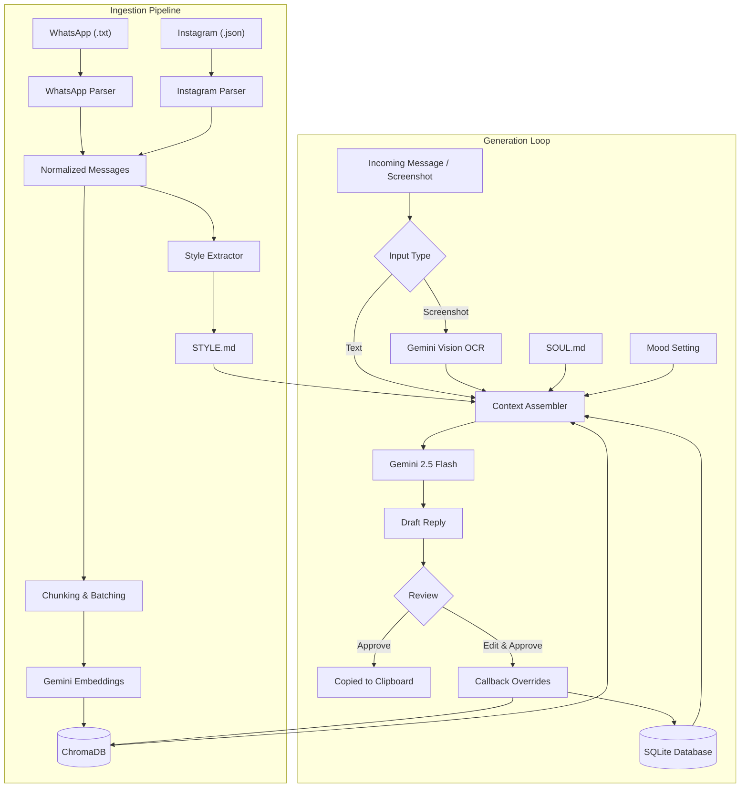

# Talking

A local texting assistant that drafts replies in your personal messaging style using your past conversation history and relationship context.

[](https://www.python.org/)
[](https://fastapi.tiangolo.com/)
[](https://ai.google.dev/)
[](https://www.trychroma.com/)
[](LICENSE)

---

## Overview

Standard language model outputs are usually obvious in casual conversations: they default to complete sentences, formal grammar, balanced paragraphs, and an upbeat customer-service tone that sounds nothing like personal messaging.

Talking addresses this by conditioning drafts on how you actually write. It analyzes your exported chat logs to measure habits like capitalization frequency, punctuation use, message length, and common abbreviations. When a message comes in, the system retrieves relevant conversation history with that contact, pairs it with your personal background notes, and generates drafts through a local web interface where you review or edit before sending.

### System Components

- **Style extraction**: Ingests WhatsApp (`.txt`) or Instagram (`.json`) exports and calculates empirical style metrics (lowercase percentage, punctuation absence, average word count, common slang) saved to `STYLE.md`.
- **Contact memory**: Stores chat history in SQLite and vectorized conversation chunks in ChromaDB with Gemini embeddings to surface past topics, inside jokes, and recent context.
- **Persona grounding**: Injects `SOUL.md`, a local file covering your background, opinions, and current life context, into the prompt.
- **Human-in-the-loop review**: Generated drafts appear in a local dashboard. You can adjust tone modifiers (chill, direct, dry, flirty), edit the draft, or copy it. User edits are saved to refine future responses for that contact.
- **Multimodal input**: Paste incoming text or drop a screenshot of the chat thread; Gemini Vision extracts the sender's text directly.

---

## Walkthrough

### Web Dashboard

The local interface runs at `http://localhost:8000` and provides a split-view workspace:

```text
+----------------------------------------------------------------------------------------+
|  Talking         [ Select Contact: Alex v ]              Ready   |   1,420 memories     |
+-------------------------------------------------+--------------------------------------+
|  CHAT & DRAFT PANEL                             |  CONTACT & SETTINGS                  |
|                                                 |                                      |
|  +-------------------------------------------+  |  Contact Profile                     |
|  | Alex: yo bro r u pullin up to the match   |  |  Name: Alex                          |
|  |       tmrw or what                        |  |  Stage: [ Close Friend v ]           |
|  |                                           |  |  Context: High school roommate       |
|  | You: yeah fr ill be there around 5, gotta |  |  Interests: Football, F1, gym        |
|  |      finish some work first tho           |  |  Inside jokes: "banana bread incident"|
|  +-------------------------------------------+  |                                      |
|                                                 |  Tone / Mood                         |
|  [Screenshot] [ Paste message here...      ] >|  [ default ] [ chill ] [ flirty ]    |
|  Ctrl+Enter to send                             |  [ deep ] [ funny ] [ dry ]          |
|                                                 |                                      |
|  AI Draft  [ 95% confidence ]                   |  Data Management                     |
|  +-------------------------------------------+  |  [ Ingest Chat Data ]                |
|  | bet im free after 4, grab food before?    |  |  [ Edit SOUL.md ]                    |
|  +-------------------------------------------+  |  [ View STYLE.md ]                   |
|  [ Edit ]  [ Regenerate ]  [ Approve & Copy ]   |                                      |
+-------------------------------------------------+--------------------------------------+
```

### Style Comparison

A comparison of responses to a casual incoming message:

*Incoming:*
> "yo bro r u pullin up to the match tmrw or what"

*Default model output:*
> "Hey! Yes, I am definitely planning on attending the match tomorrow. What time were you thinking of heading over? Let me know!"

*Talking draft (conditioned on style profile):*
> "yeah fr ill be there around 5, gotta finish some work first tho"

The draft reflects lower capitalization rates, common shorthand, and shorter sentence length based on the extracted style profile.

### Extracted Style Profile (`STYLE.md`)

During ingestion, the parser aggregates messaging habits into a structured profile:

```markdown
# Texting Fingerprint (Example)

## Capitalization
- Proper casing: 78%
- Mostly lowercase: 18%
- Uppercase: 4%

## Punctuation
- No terminal punctuation: 91%
- Question marks: 6%
- Periods: 3%

## Structure & Vocabulary
- Average message length: 24 characters (approx. 5 words)
- Common abbreviations: u, fr, idk, ofc, rn, tho
```

---

## Architecture



---

## Getting Started

### Prerequisites

- Python 3.10 or newer
- A Google Gemini API key from [Google AI Studio](https://aistudio.google.com/app/apikey)

### Installation

1. Clone the repository:
   ```bash
   git clone https://github.com/tezz-e/talking.git
   cd talking
   ```

2. Create and activate a virtual environment:
   ```bash
   # Windows
   python -m venv venv
   .\venv\Scripts\activate

   # Linux / macOS
   python3 -m venv venv
   source venv/bin/activate
   ```

3. Install dependencies:
   ```bash
   pip install -r requirements.txt
   ```

4. Configure environment variables:
   ```bash
   cp .env.example .env
   # On Windows: copy .env.example .env
   ```
   Add your Gemini API key inside `.env`:
   ```env
   GEMINI_API_KEY=your_gemini_api_key_here
   ```

5. Start the application:
   ```bash
   python run.py
   ```
   Or run `start_server.bat` on Windows. The web interface will be available at `http://localhost:8000`.

---

## Ingesting Chat History

To build your style profile and semantic memory store:

### Using the Web UI
1. Open the dashboard and click **Ingest Chat Data** in the right sidebar.
2. Select the platform (Instagram or WhatsApp).
3. Enter your display name exactly as it appears in the chat files.
4. Leave the path blank if files are placed in `data/exports/`, or provide an absolute path to the export folder.

### Exporting WhatsApp Chats
1. In WhatsApp on your phone, open a chat.
2. Tap the contact name > **Export Chat** > **Without Media**.
3. Place the exported `.txt` file into `data/exports/whatsapp/`.

### Exporting Instagram Messages
1. Go to Instagram **Settings** > **Accounts Center** > **Your information and permissions** > **Download your information**.
2. Select **Some of your information** > **Messages**.
3. Choose **JSON** as the format and select your desired date range.
4. Extract the download and place the `messages/inbox/` directory into `data/exports/instagram/`.

---

## Persona Configuration (`SOUL.md`)

Talking reads `data/SOUL.md` to ground generations in who you are. A template is provided at `data/SOUL.template.md`. Copy it to `data/SOUL.md` (or edit it via the web interface):

```markdown
# Who I Am
- **Name**: Alex
- **Core vibe**: dry humor, relaxed

# My Interests
- **Hobbies**: photography, cycling, analog synthesizers
- **Music**: indie rock, post-punk, electronic

# Opinions and Habits
- **Hot takes**: cold brew over drip coffee, prefer physical books
- **Pet peeves**: unannounced voice calls, leaving messages on read for days
```

> Note: `data/SOUL.md` and `data/STYLE.md` are ignored by git so personal details are never committed.

---

## Project Structure

```text
Talking/
├── backend/
│   ├── ingestion/
│   │   ├── instagram.py         # Parses Instagram JSON archives and normalizes encoding
│   │   ├── whatsapp.py          # Parses Android & iOS WhatsApp .txt exports
│   │   └── style_extractor.py   # Aggregates messaging metrics into STYLE.md
│   ├── context.py               # Assembles prompt context (DB + Chroma + Soul + Style)
│   ├── database.py              # SQLite storage for contacts, history, and facts
│   ├── instagram_watcher.py     # Optional Playwright automation for real-time monitoring
│   ├── llm.py                   # Gemini client with exponential backoff and vision OCR
│   ├── main.py                  # FastAPI server endpoints
│   ├── memory.py                # ChromaDB vector store integration
│   ├── models.py                # Pydantic data schemas
│   ├── personality.py           # System prompt builder and mood modifiers
│   └── strategy.py              # Natural language conversation goal parser
├── data/
│   ├── db/                      # Local SQLite and ChromaDB files (git-ignored)
│   ├── exports/                 # Chat export files (git-ignored)
│   ├── SOUL.template.md         # Template for identity and background notes
│   └── STYLE.template.md        # Template for style fingerprint
├── frontend/
│   ├── app.js                   # Client-side UI logic and hotkeys
│   ├── index.html               # Web dashboard markup
│   └── style.css                # Dashboard styling
├── tests/                       # Verification and diagnostic scripts
├── .env.example                 # Configuration template
├── .gitignore                   # Excludes personal data, databases, and keys
├── LICENSE                      # MIT License
├── requirements.txt             # Pinned Python dependencies
├── run.py                       # Application entrypoint
└── start_server.bat             # Windows startup script
```

---

## Data Privacy

- **Local storage**: SQLite databases, ChromaDB vector files, session data, and raw exports stay strictly on your local disk.
- **Git exclusion**: `.gitignore` is configured to exclude all databases (`data/db/`), exports (`data/exports/`), browser sessions (`data/ig_session/`), `.env`, and personal markdown files (`data/SOUL.md`, `data/STYLE.md`, `data/*.md`).
- **External calls**: The application only connects to Google's Gemini API endpoints using your provided API key to run completions, embeddings, and vision OCR. No telemetry or secondary servers are used.

---

## License

MIT License. See [LICENSE](LICENSE) for details.
