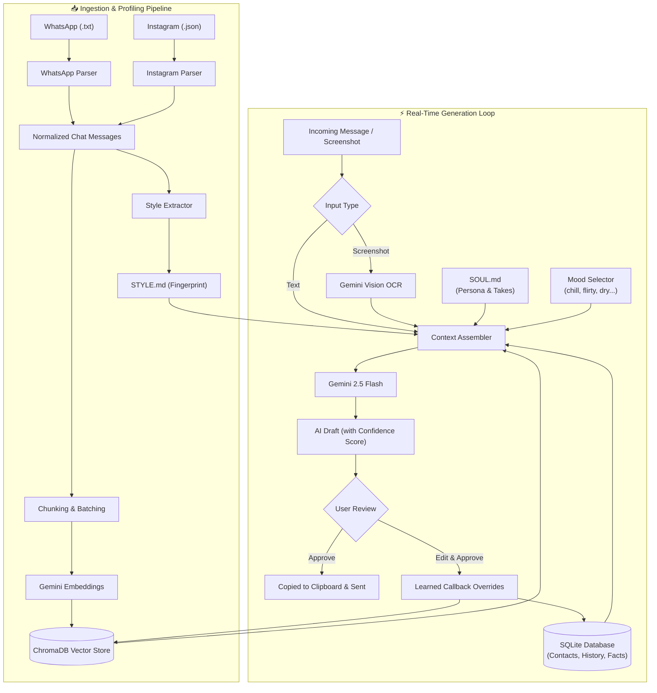

<div align="center">

# 🧠 Talking

### *The AI Texting Autopilot that Clones Your Authentic Personality*

[](https://www.python.org/)
[](https://fastapi.tiangolo.com/)
[](https://ai.google.dev/)
[](https://www.trychroma.com/)
[](LICENSE)
[](https://github.com/)

<p align="center">
  <a href="#-showcase">Showcase</a> •
  <a href="#-the-problem-vs-the-solution">The Problem vs Solution</a> •
  <a href="#-key-features">Key Features</a> •
  <a href="#-system-architecture">Architecture</a> •
  <a href="#-quick-start">Quick Start</a> •
  <a href="#-chat-ingestion-guide">Ingestion Guide</a> •
  <a href="#-project-structure">Project Structure</a> •
  <a href="#-privacy--security">Privacy & Security</a>
</p>

---

</div>

## 💡 What is Talking?

Most AI messaging assistants sound like a corporate chatbot: overly enthusiastic, punctuation-obsessed, and riddled with emojis like 🚀 and ✨. Anyone on the other end immediately knows it's an AI.

**Talking** is a personal texting copilot designed to be indistinguishable from **you**. It ingests your actual chat exports (WhatsApp and Instagram), derives an empirical **Texting Fingerprint** (`STYLE.md`), grounds itself in your personal identity and backstory (`SOUL.md`), and uses semantic vector memory (**ChromaDB**) to retrieve shared inside jokes, past stories, and relationship context for every contact.

Whether you're handling DMs, catching up with friends, or navigating nuanced conversations, **Talking** generates drafts in your genuine voice with human-in-the-loop control.

---

## 📸 Showcase

### 1. The Glassmorphic Cyberpunk Web Dashboard

A responsive, high-aesthetic web interface equipped with live memory indicators, contact relationship managers, real-time draft generation, and lightning-fast keyboard shortcuts (`Ctrl+Enter` to send, `Ctrl+Shift+C` to copy).

```text
┌────────────────────────────────────────────────────────────────────────────────────────┐
│  🧠 Talking      [ Select Contact: Alex ▾ ]              ● Ready   |   1,420 memories  │
├─────────────────────────────────────────────────┬──────────────────────────────────────┤
│  CHAT & DRAFT PANEL                             │  CONTACT & STRATEGY PANEL            │
│                                                 │                                      │
│  ┌───────────────────────────────────────────┐  │  👤 Contact Profile                  │
│  │ Alex: yo bro r u pullin up to the match   │  │  Name: Alex                          │
│  │       tmrw or what                        │  │  Stage: [ Close Friend ▾ ]           │
│  │                                           │  │  How you know: High school roommate  │
│  │ You: yeah fr ill be there around 5, gotta │  │  Interests: Arsenal, F1, gym         │
│  │      finish some work first tho           │  │  Inside jokes: "banana bread incident"│
│  └───────────────────────────────────────────┘  │                                      │
│                                                 │  🎛️ AI Controls                      │
│  [🖼️] [ Paste message or drop screenshot... ] ➤│  Mood: [ default ] [ chill ] [ flirty ]│
│  Ctrl+Enter to send                             │         [ deep ] [ funny ] [ dry ]    │
│                                                 │                                      │
│  ✨ AI Draft  [ 95% Confidence ]                │  📂 Data Management                  │
│  ┌───────────────────────────────────────────┐  │  [📥 Ingest Chat Data]               │
│  │ bet im free after 4, grab food before?    │  │  [🧬 Edit SOUL.md]                   │
│  └───────────────────────────────────────────┘  │  [🎨 View STYLE.md]                  │
│  [✏️ Edit]  [🔄 Regenerate]  [✅ Approve & Copy] │                                      │
└─────────────────────────────────────────────────┴──────────────────────────────────────┘
```

---

### 2. Side-by-Side: Generic AI vs. Talking

| Scenario | Incoming Message | Generic ChatGPT Response ❌ | Talking Response ✅ |
| :--- | :--- | :--- | :--- |
| **Friend asking for plans** | *"yo bro r u pullin up to the match tmrw or what"* | *"Hello! Yes, I am definitely planning to attend the match tomorrow. What time will you be arriving? Looking forward to it! ⚽🎉"* | *"yeah fr ill be there around 5, gotta finish some work first tho"* |
| **Crush / Playful banter** | *"i bet you were asleep all day lazy"* | *"Haha, no way! I actually had a very productive day running errands and studying. What about you? 😊"* | *"lmao as if, was literally up at 8. you're the one who just woke up rn"* |
| **Late night check-in** | *"can't sleep, overthinking life again"* | *"I'm sorry to hear that. Overthinking can be really tough. Would you like to talk through what is troubling you?"* | *"damn what happened, talk to me"* |

---

### 3. Quantitative Texting Fingerprint (`STYLE.md`)

Talking doesn't guess how you text; it statistically calculates your exact messaging signature across thousands of your past messages:

```markdown
## Texting Fingerprint Summary (Example)
*   **Capitalization:** 80% proper casing, 20% lowercase.
*   **Punctuation Habits:** 92% of messages contain no terminal punctuation.
*   **Message Structure:** Average length is 5 words (24 characters).
*   **Top Abbreviations:** `u`, `fr`, `omg`, `idk`, `ofc`, `tryna`, `smth`.
*   **Emoji Cadence:** 0.05 emojis per message.
```

---

### 4. Multimodal Screenshot OCR

No need to re-type long chat threads. Simply paste or upload a screenshot of your chat directly into the dashboard. Powered by **Gemini 2.5 Flash Vision**, the engine automatically filters out system headers, battery indicators, and timestamps to extract only the relevant incoming message.

---

## 🚀 Key Features

* **🧬 Personality Core (`SOUL.md`)**: Configurable identity definition capturing your background, hot takes, favorite music/movies, communication boundaries, and life updates.
* **🎨 Statistical Style Engine (`STYLE.md`)**: Automated extraction from real WhatsApp and Instagram message archives analyzing capitalization, slang, punctuation, and length distribution.
* **🧠 Semantic Vector RAG (ChromaDB + Gemini Embeddings)**: Context-aware retrieval of past shared memories, topics, and specific conversations for each contact.
* **🎛️ Dynamic Mood & Relationship Matrix**: Switch between 6 distinct conversational moods on the fly (`default`, `chill`, `flirty`, `deep`, `funny`, `dry`) across 10 relationship tiers (from `stranger` to `close_friend` to `partner`).
* **🔄 Active Learning & Learned Callbacks**: If you edit an AI draft before copying, Talking records the edit as an active override. Next time a similar prompt occurs, the engine prefers your exact phrasing.
* **🖼️ Multimodal Screenshot OCR**: Direct screenshot upload and OCR pipeline via Gemini Vision to ingest conversations with zero manual typing.
* **🤖 Headless Instagram DM Watcher**: Optional Playwright-based background agent that monitors live Instagram DMs and generates pending drafts in real-time.
* **⚡ Hotkey-First Glassmorphic UX**: Designed for rapid response workflows (`Ctrl+Enter` to generate, `Ctrl+Shift+C` to approve & copy to clipboard).

---

## 📐 System Architecture



---

## 📦 Quick Start

### Prerequisites

* **Python 3.10+**
* A free **Google Gemini API Key** (obtainable from [Google AI Studio](https://aistudio.google.com/app/apikey))

### 1. Clone the Repository

```bash
git clone https://github.com/your-username/talking.git
cd talking
```

### 2. Set Up a Virtual Environment

```bash
# Windows
python -m venv venv
.\venv\Scripts\activate

# macOS / Linux
python3 -m venv venv
source venv/bin/activate
```

### 3. Install Dependencies

```bash
pip install -r requirements.txt
```

### 4. Configure Your Environment

Copy the example environment template and add your Gemini API key:

```bash
# Windows
copy .env.example .env

# macOS / Linux
cp .env.example .env
```

Open `.env` and paste your key:
```ini
GEMINI_API_KEY="your-gemini-api-key-here"
```

### 5. Launch the Dashboard

Run the server via Python or use the provided batch script on Windows:

```bash
python run.py
```
*Or on Windows, simply double-click `start_server.bat`.*

Navigate to **`http://localhost:8000`** in your browser.

---

## 📥 Chat Ingestion Guide

To train Talking on your authentic voice:

### Option A: Via the Web Dashboard
1. Click **"📥 Ingest Chat Data"** in the sidebar.
2. Select your platform (**Instagram** or **WhatsApp**).
3. Enter your exact display name as it appears in the chat export.
4. Place the export files in `data/exports/` (or specify a custom path) and click **"🚀 Start Ingestion"**.

### Option B: Exporting from WhatsApp
1. Open any WhatsApp conversation on your phone.
2. Tap the contact's name → **Export Chat** → **Without Media**.
3. Save the resulting `.txt` file into `data/exports/whatsapp/`.

### Option C: Exporting from Instagram
1. Go to **Instagram Settings** → **Accounts Center** → **Your information and permissions** → **Download your information**.
2. Select **Some of your information** → **Messages**.
3. Choose **JSON** as the format and set date range to your desired period.
4. Extract the downloaded archive and place the `messages/` or `inbox/` folder into `data/exports/instagram/`.

---

## 🧬 Customizing Your Persona (`SOUL.md`)

Talking reads `data/SOUL.md` on every generation turn. Customize it to reflect your true background:

```markdown
# Who I Am
- **Name**: Alex
- **Core vibe**: sarcastic, chill, witty

# My Interests
- **Hobbies**: photography, rock climbing, music production
- **Music**: synthwave, hip-hop, indie rock

# My Opinions & Hot Takes
- **Hot takes**: cold brew over hot coffee, physical media > streaming
- **Pet peeves**: dry one-word replies, leaving voice notes over 2 minutes
```

---

## 🗂️ Project Structure

```text
Talking/
├── backend/
│   ├── ingestion/
│   │   ├── instagram.py         # Parses Instagram JSON archives & fixes encoding
│   │   ├── whatsapp.py          # Parses Android & iOS WhatsApp .txt exports
│   │   └── style_extractor.py   # Computes empirical texting statistics into STYLE.md
│   ├── context.py               # RAG context assembler (DB + Vector + Soul + Style)
│   ├── database.py              # SQLite storage for contacts, history & facts
│   ├── instagram_watcher.py     # Playwright automation for real-time Instagram DMs
│   ├── llm.py                   # Google GenAI wrapper with exponential backoff & OCR
│   ├── main.py                  # FastAPI server endpoints
│   ├── memory.py                # ChromaDB vector store integration
│   ├── models.py                # Pydantic v2 domain & API schemas
│   ├── personality.py           # System prompt generator & mood controller
│   └── strategy.py              # Dynamic conversation goal parser
├── data/
│   ├── db/                      # Local SQLite and ChromaDB data (git-ignored)
│   ├── exports/                 # Dropped chat exports (git-ignored)
│   ├── SOUL.md                  # Personal identity, background, and opinions
│   └── STYLE.md                 # Statistical texting fingerprint
├── frontend/
│   ├── app.js                   # Client logic, hotkeys, and API integration
│   ├── index.html               # Glassmorphic dashboard interface
│   └── style.css                # Cyberpunk glass styling & responsive layouts
├── tests/                       # Unit tests & diagnostic scripts
├── .env.example                 # Environment configuration template
├── .gitignore                   # Safe Git defaults protecting data & keys
├── LICENSE                      # MIT License
├── requirements.txt             # Pinned project dependencies
├── run.py                       # Server entry point
└── start_server.bat             # One-click Windows starter
```

---

## 🔒 Privacy & Security

* **100% Local Data Storage:** All your chat archives, contact databases, ChromaDB vector stores, and browser cookies stay completely on your local machine.
* **Zero Third-Party Telemetry:** No user analytics, external trackers, or database syncs.
* **Direct LLM Calls:** Only the anonymized prompt context is sent to the official Google Gemini API using your private API key.
* **Git-Protected:** Sensitive files (`.env`, `data/db/`, `data/exports/`, `data/ig_session/`) are strictly ignored in `.gitignore`.

---

## 🤝 Contributing

Contributions, bug reports, and enhancements are welcome!

1. Fork the Project
2. Create your Feature Branch (`git checkout -b feature/AmazingFeature`)
3. Commit your Changes (`git commit -m 'Add AmazingFeature'`)
4. Push to the Branch (`git push origin feature/AmazingFeature`)
5. Open a Pull Request

---

## 📄 License

This project is licensed under the MIT License — see the [LICENSE](LICENSE) file for details.
